# Prints dos testes — Banco `gestec`

3ª Avaliação de Banco de Dados Relacional. Para cada item: o **problema** que resolve, onde está o **código SQL** e o **retorno obtido** (print do MySQL Workbench).

- Código dos objetos: [`scripts/03_programacao.sql`](../scripts/03_programacao.sql)
- Chamadas usadas nos testes: [`scripts/04_testes.sql`](../scripts/04_testes.sql)

## Sumário

- [Carga de dados (DML)](#carga-de-dados-dml)
- [Functions (F1 a F6)](#functions)
- [Views (V1 a V3)](#views)
- [Stored procedures (P1 a P6)](#stored-procedures)
- [Triggers (T1 a T6)](#triggers)

---

## Carga de dados (DML)

### DML1 — Contagem de registros por tabela

**Problema:** conferir se cada tabela recebeu pelo menos 50 registros (exceções permitidas: `sla_config`, `departamentos` e `travas`).

**Código:** [`scripts/02_inserts.sql`](../scripts/02_inserts.sql) (a consulta de conferência está no final do arquivo)

**Retorno:**

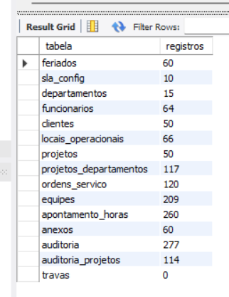

---

## Functions

### F1 — `fn_calcular_data_sla`

**Problema:** o prazo (SLA) das O.S. de manutenção é contado em dias úteis. A função calcula a data limite pulando sábados, domingos e feriados.

**Conceitos:** laço `WHILE` e subconsulta na tabela `feriados`.

**Código:** [`scripts/03_programacao.sql`](../scripts/03_programacao.sql)

**Retorno:**

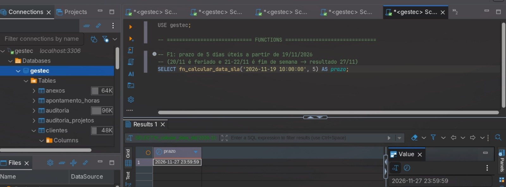

### F2 — `fn_total_horas_os`

**Problema:** saber quantas horas já foram trabalhadas em uma O.S., somando os apontamentos.

**Conceitos:** função de grupo `SUM`.

**Código:** [`scripts/03_programacao.sql`](../scripts/03_programacao.sql)

**Retorno:**

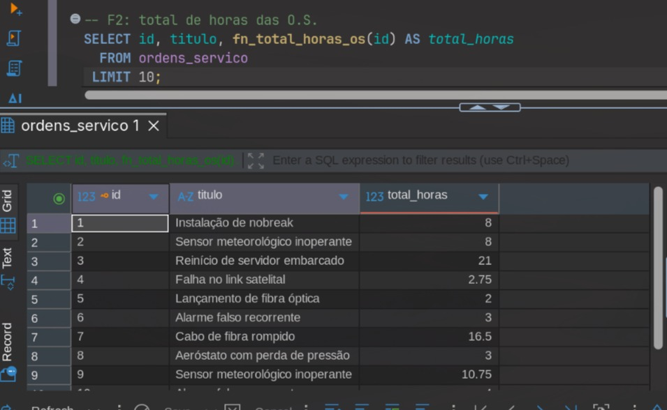

### F3 — `fn_status_sla`

**Problema:** mostrar se a O.S. está no prazo, atrasada, concluída no prazo, concluída com atraso ou sem prazo definido.

**Conceitos:** estrutura `IF / ELSEIF`.

**Código:** [`scripts/03_programacao.sql`](../scripts/03_programacao.sql)

**Retorno:**

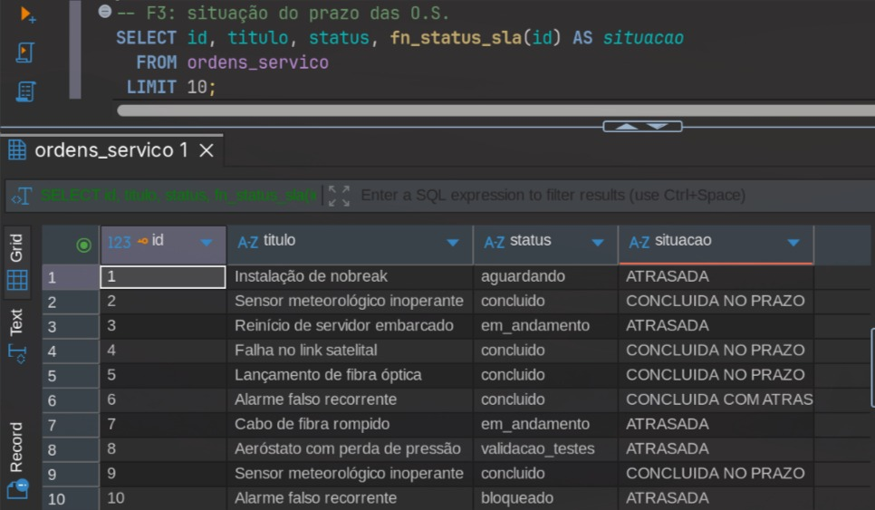

### F4 — `fn_qtd_os_abertas_funcionario`

**Problema:** medir a carga de trabalho de um técnico, contando as O.S. que ainda estão abertas com ele.

**Conceitos:** função de grupo `COUNT`.

**Código:** [`scripts/03_programacao.sql`](../scripts/03_programacao.sql)

**Retorno:**

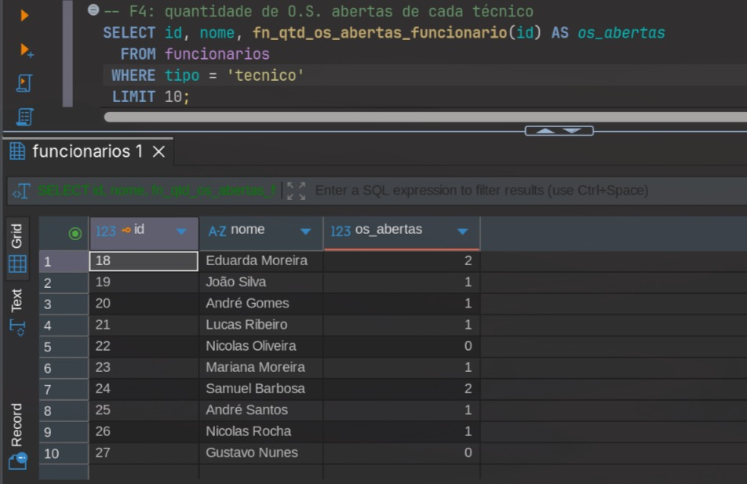

### F5 — `fn_percentual_conclusao_projeto`

**Problema:** acompanhar o andamento de um projeto pelo percentual de O.S. concluídas.

**Conceitos:** `COUNT` e subconsultas.

**Código:** [`scripts/03_programacao.sql`](../scripts/03_programacao.sql)

**Retorno:**

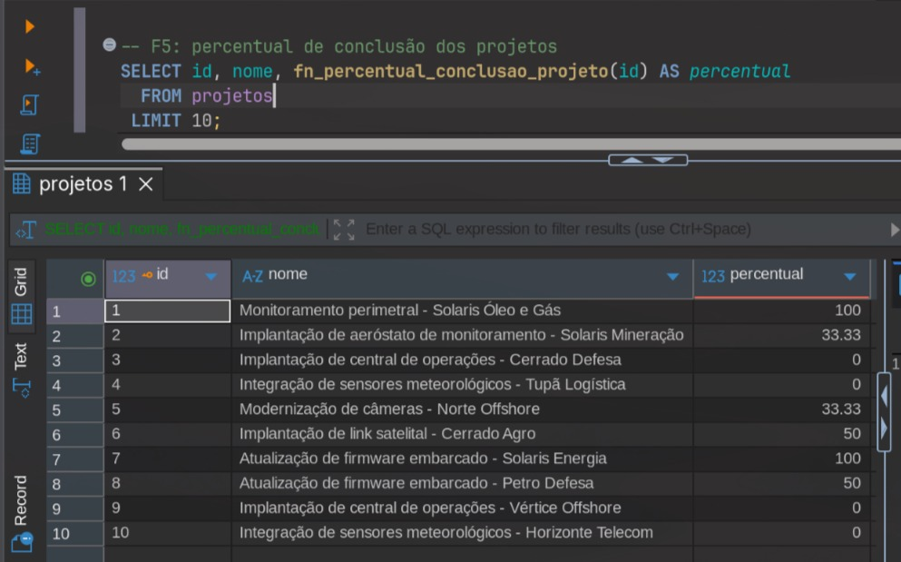

### F6 — `fn_tempo_medio_atendimento_dep`

**Problema:** comparar os departamentos pelo tempo médio, em dias, entre a abertura e a conclusão das O.S.

**Conceitos:** `INNER JOIN` e função de grupo `AVG`.

**Código:** [`scripts/03_programacao.sql`](../scripts/03_programacao.sql)

**Retorno:**

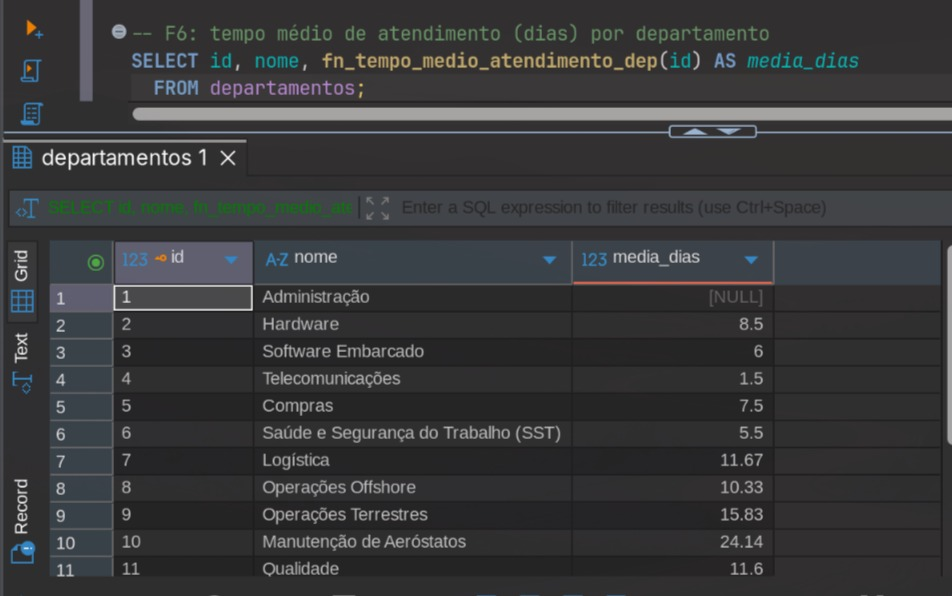

---

## Views

### V1 — `vw_os_detalhada`

**Problema:** nas O.S. aparecem só os IDs. A view troca os IDs pelos nomes de departamento, solicitante, responsável e cliente.

**Conceitos:** `INNER JOIN` (departamento e solicitante sempre existem) e `LEFT JOIN` (responsável e cliente podem estar vazios).

**Código:** [`scripts/03_programacao.sql`](../scripts/03_programacao.sql)

**Retorno:**

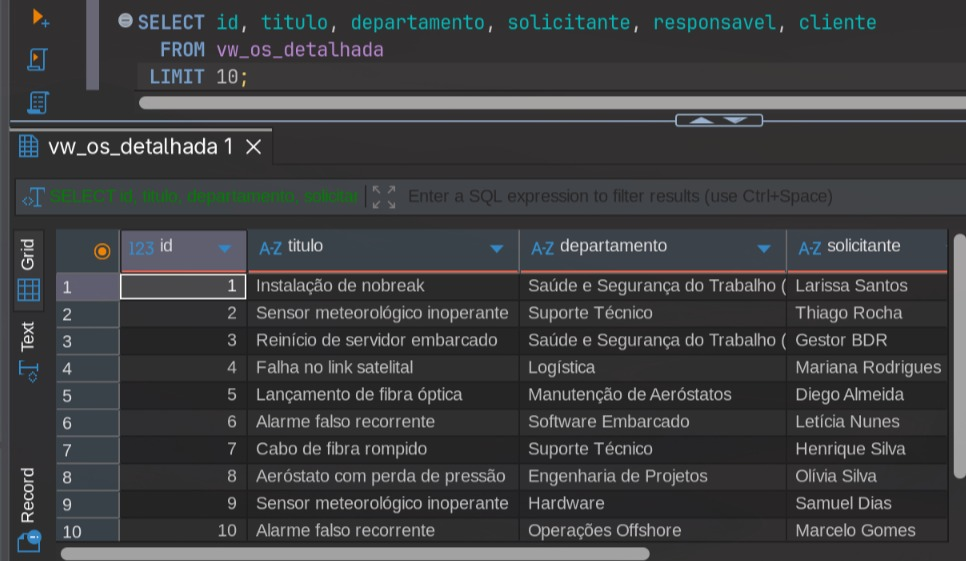

### V2 — `vw_horas_por_funcionario`

**Problema:** ver o total de horas de cada funcionário, incluindo quem ainda não lançou horas (aparece com 0).

**Conceitos:** `RIGHT JOIN`, `GROUP BY` e funções de grupo.

**Código:** [`scripts/03_programacao.sql`](../scripts/03_programacao.sql)

**Retorno:**

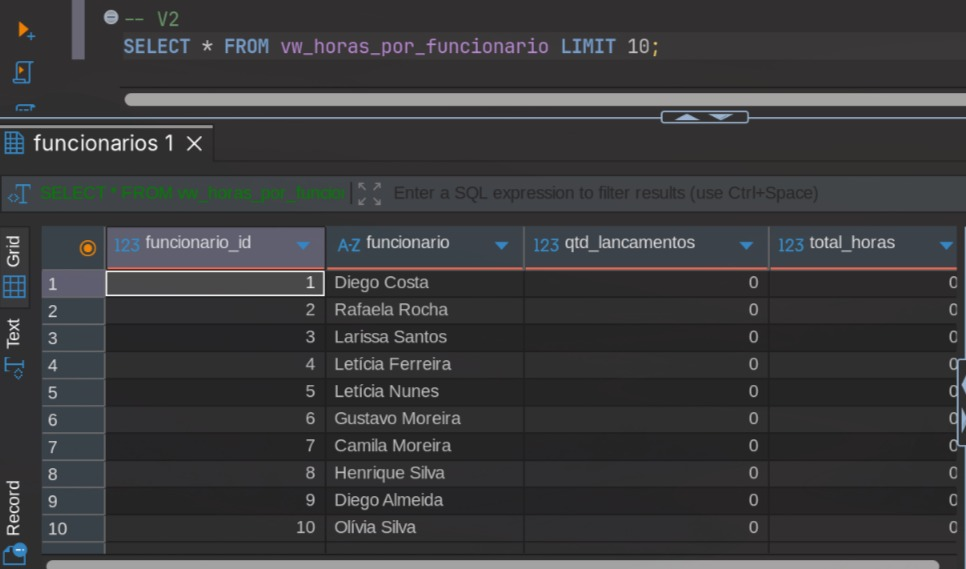

### V3 — `vw_os_atrasadas`

**Problema:** listar as O.S. ainda abertas cujo prazo já venceu.

**Conceitos:** view construída sobre outra view (`vw_os_detalhada`).

**Código:** [`scripts/03_programacao.sql`](../scripts/03_programacao.sql)

**Retorno:**

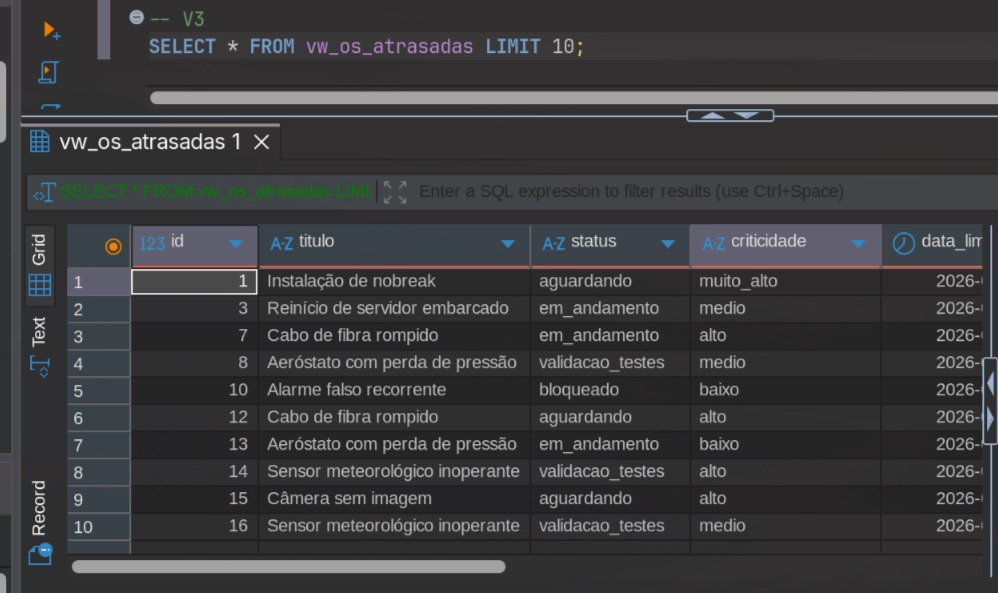

---

## Stored procedures

### P1 — `sp_abrir_os`

**Problema:** abrir uma O.S. garantindo que o solicitante seja gestor ou analista, e devolver o ID criado. O prazo é calculado pelo trigger T1.

**Conceitos:** `SIGNAL` (erro personalizado), subconsulta com `EXISTS` e parâmetro `OUT`.

**Código:** [`scripts/03_programacao.sql`](../scripts/03_programacao.sql)

**Retorno:**

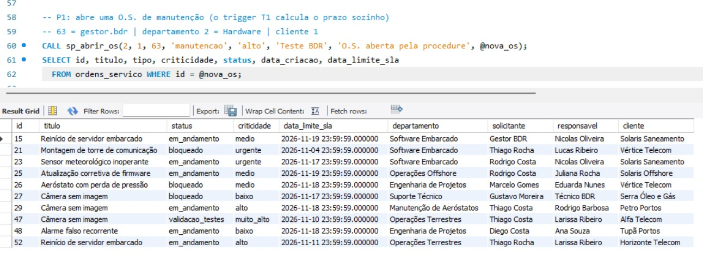

### P2 — `sp_alterar_status_os`

**Problema:** mudar o status de uma O.S. respeitando as regras: O.S. concluída não muda mais, e para concluir o parecer técnico é obrigatório.

**Conceitos:** `SIGNAL` e `IF`.

**Código:** [`scripts/03_programacao.sql`](../scripts/03_programacao.sql)

**Retorno:**

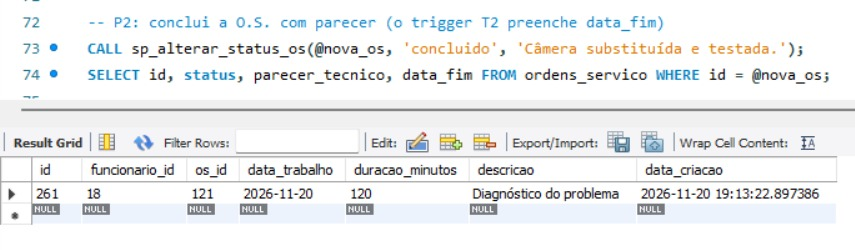

### P3 — `sp_atribuir_responsavel`

**Problema:** atribuir um técnico a uma O.S. O técnico precisa ser do mesmo departamento da O.S. e passa a fazer parte da equipe.

**Conceitos:** subconsultas, `SIGNAL` e `INSERT IGNORE`.

**Código:** [`scripts/03_programacao.sql`](../scripts/03_programacao.sql)

**Retorno:**

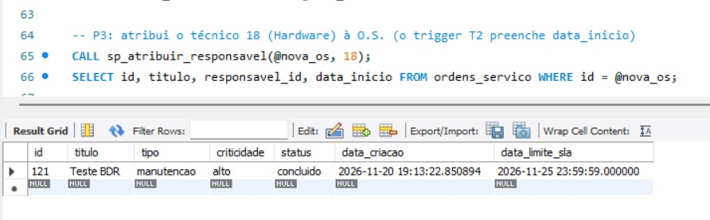

### P4 — `sp_registrar_horas`

**Problema:** o técnico registra as horas gastas em uma O.S. A O.S. não pode estar concluída e o funcionário precisa ser o responsável ou fazer parte da equipe. É a procedure usada na Parte 5 (conexão com a API).

**Conceitos:** `SIGNAL` e subconsultas com `EXISTS`.

**Código:** [`scripts/03_programacao.sql`](../scripts/03_programacao.sql)

**Retorno:**

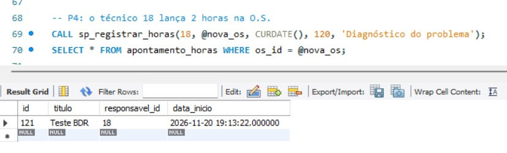

### P5 — `sp_relatorio_cliente`

**Problema:** gerar o relatório de um cliente com as suas O.S., as horas trabalhadas e a situação do prazo de cada uma.

**Conceitos:** `CURSOR` (percorre as O.S. uma a uma), `HANDLER` e tabela temporária. Chama as functions F2 e F3.

**Código:** [`scripts/03_programacao.sql`](../scripts/03_programacao.sql)

**Retorno:**

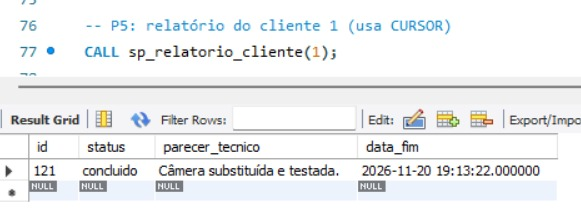

### P6 — `sp_resumo_departamentos`

**Problema:** ver, por departamento, quantas O.S. existem, quantas estão abertas e quantas foram concluídas.

**Conceitos:** `LEFT JOIN`, `GROUP BY` e funções de grupo (`COUNT`, `SUM`).

**Código:** [`scripts/03_programacao.sql`](../scripts/03_programacao.sql)

**Retorno:**

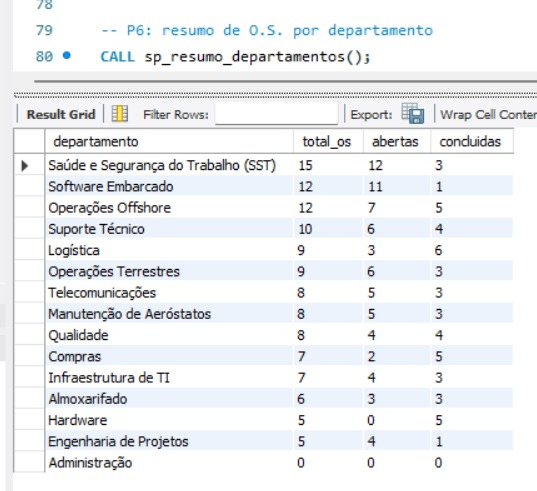

---

## Triggers

> Os triggers T3, T5 e T6 bloqueiam operações erradas. Nesses casos o print mostra a **mensagem de erro**, que é o resultado esperado.

### T1 — `trg_os_bi_sla` (antes de inserir O.S.)

**Problema:** toda O.S. de manutenção precisa nascer com o prazo calculado conforme a criticidade (tabela `sla_config`), sem depender de quem cadastra.

**Conceitos:** `BEFORE INSERT` e uso da function F1.

**Código:** [`scripts/03_programacao.sql`](../scripts/03_programacao.sql)

**Retorno:**

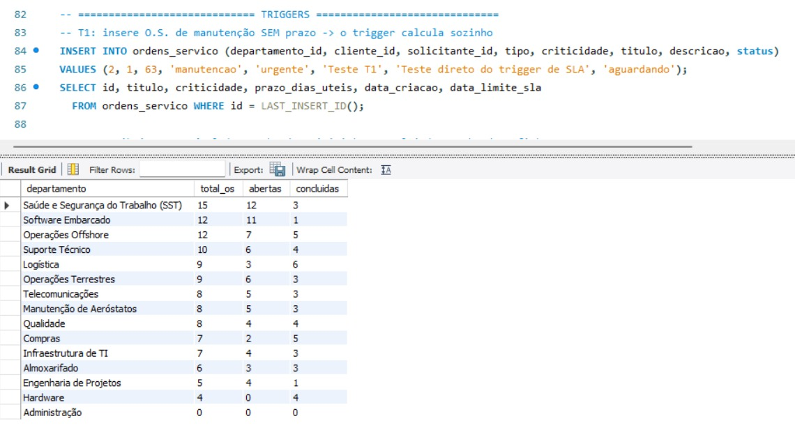

### T2 — `trg_os_bu_datas` (antes de atualizar O.S.)

**Problema:** preencher sozinho a data de início (quando a O.S. recebe um responsável) e a data de fim (quando é concluída).

**Conceitos:** `BEFORE UPDATE`.

**Código:** [`scripts/03_programacao.sql`](../scripts/03_programacao.sql)

**Retorno:**

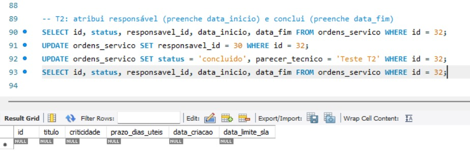

### T3 — `trg_clientes_bu_inativar` (antes de atualizar cliente)

**Problema:** não deixar inativar um cliente que ainda tem O.S. abertas.

**Conceitos:** `BEFORE UPDATE`, subconsulta com `EXISTS` e `SIGNAL`.

**Código:** [`scripts/03_programacao.sql`](../scripts/03_programacao.sql)

**Retorno (mensagem de erro esperada):**

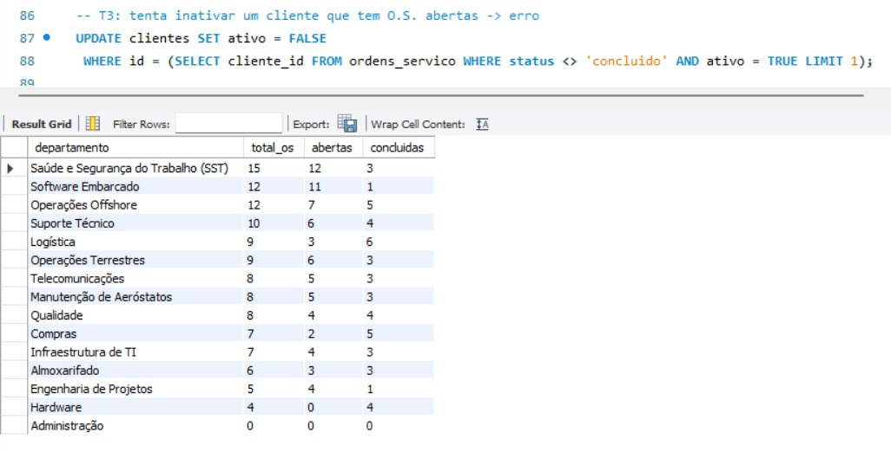

### T4 — `trg_projetos_bu_datas` (antes de atualizar projeto)

**Problema:** registrar sozinho as datas de início e fim do projeto quando o status muda para `em_andamento` ou `concluido`.

**Conceitos:** `BEFORE UPDATE`.

**Código:** [`scripts/03_programacao.sql`](../scripts/03_programacao.sql)

**Retorno:**

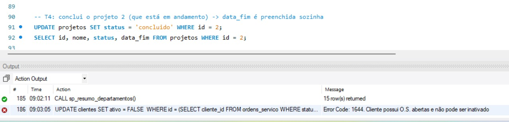

### T5 — `trg_horas_bi_validacao` (antes de inserir horas)

**Problema:** impedir lançamento de horas em data futura e impedir mais de 24 horas no mesmo dia para o mesmo funcionário.

**Conceitos:** `BEFORE INSERT`, subconsulta com `SUM` e `SIGNAL`.

**Código:** [`scripts/03_programacao.sql`](../scripts/03_programacao.sql)

**Retorno (mensagem de erro esperada):**

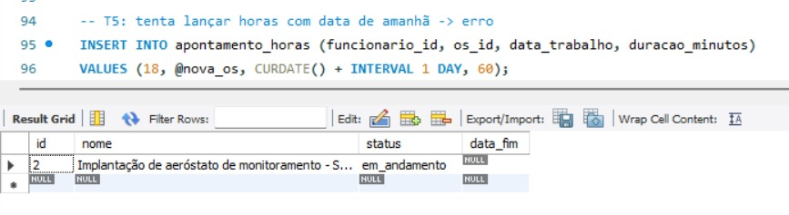

### T6 — `trg_anexos_bi_limite` (antes de inserir anexo)

**Problema:** limitar a 10 o número de anexos de cada O.S.

**Conceitos:** `BEFORE INSERT`, subconsulta com `COUNT` e `SIGNAL`.

**Código:** [`scripts/03_programacao.sql`](../scripts/03_programacao.sql)

**Retorno (mensagem de erro esperada):**

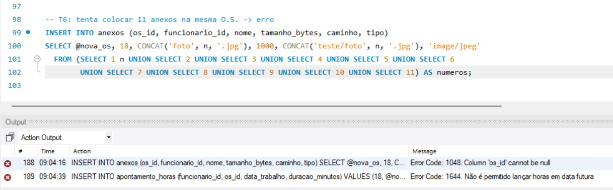
