# 3ª Avaliação de Banco de Dados Relacional

**FATEC — Banco de Dados Relacional — 2º Semestre de 2026**

**Projeto SGOS / GesTec** — Sistema de Gestão de Ordens de Serviço (banco de dados em MySQL)

- **Alunos:** Marina Duque e Pamela Iwabuchi
- **Turma:** 2DSM
- **Professor:** Juliana Pasquini
- **Data de entrega:** 23/11/2026
- **Repositório:** https://github.com/pamelaiwabuchi/banco_gestec

---

## 1. Introdução

Este trabalho apresenta a modelagem, a implementação e a programação do banco de dados relacional do SGOS/GesTec (Sistema de Gestão de Ordens de Serviço), tema do projeto API da disciplina.

O sistema controla ordens de serviço (O.S.) de instalação e de manutenção abertas para clientes. Ele reúne departamentos, funcionários com perfil de gestor, analista ou técnico, projetos, equipes, apontamento de horas, anexos, prazos de SLA contados em dias úteis e a auditoria das alterações.

O banco foi implementado em MySQL (banco `gestec`) e os testes foram executados no MySQL Workbench. Para cada item de programação (functions, views, stored procedures e triggers), este documento mostra o problema que ele resolve, o código SQL e o retorno obtido.

### 1.1 Arquivos entregues

O script de criação das tabelas, o script de inserção de dados e o dicionário de dados são entregues em arquivos separados:

| Arquivo | Conteúdo |
|---|---|
| [`scripts/01_create_tables.sql`](../scripts/01_create_tables.sql) | Criação das 15 tabelas (DDL) |
| [`scripts/02_inserts.sql`](../scripts/02_inserts.sql) | Inserção de dados fictícios (DML) |
| [`scripts/03_programacao.sql`](../scripts/03_programacao.sql) | 6 functions, 3 views, 6 stored procedures e 6 triggers |
| [`scripts/04_testes.sql`](../scripts/04_testes.sql) | Chamadas de teste de cada objeto, usadas nos prints |
| [`dicionario_de_dados.md`](../dicionario_de_dados.md) | Dicionário de dados (Parte 4) |
| [`docs/PRINTS.md`](PRINTS.md) e `prints/` | Prints dos testes, organizados por tipo de objeto |
| [`sgos-mysql/`](../sgos-mysql) | Sistema SGOS adaptado para MySQL (Parte 5) |

## 2. Parte 1 — Modelos de banco de dados

### 2.1 Modelo conceitual

O modelo conceitual representa as entidades do SGOS, seus atributos e os relacionamentos entre elas.

> ⚠️ Adicione a imagem em `docs/modelos/modelo_conceitual.png`.

### 2.2 Modelo lógico

O modelo lógico traduz o modelo conceitual para tabelas, com chaves primárias, chaves estrangeiras e os tipos de dados do MySQL.

> ⚠️ Adicione a imagem em `docs/modelos/modelo_logico.png`.

## 3. Parte 2 — Criação das tabelas e inserção de dados

### 3.1 Criação das tabelas (DDL)

O script [`scripts/01_create_tables.sql`](../scripts/01_create_tables.sql) cria as 15 tabelas do banco com chaves primárias, chaves estrangeiras, restrições UNIQUE e CHECK e índices de consulta. Todas as tabelas usam o motor InnoDB e o conjunto de caracteres utf8mb4.

As tabelas `departamentos` e `funcionarios` dependem uma da outra (o departamento tem um funcionário responsável e o funcionário pertence a um departamento). Para resolver essa dependência circular, a chave estrangeira do responsável é criada com `ALTER TABLE` depois que `funcionarios` existe.

O script pode ser executado novamente: ele apaga e recria as tabelas.

### 3.2 Inserção de dados (DML)

O script [`scripts/02_inserts.sql`](../scripts/02_inserts.sql) insere dados fictícios (empresas e pessoas inventadas) em todas as tabelas. Todos os funcionários cadastrados têm a senha `Senha@123` (armazenada como hash bcrypt).

| Tabela | Finalidade | Chaves estrangeiras | Registros |
|---|---|---|--:|
| `feriados` | Feriados desconsiderados na contagem de dias úteis do SLA | — | 60 |
| `sla_config` | Prazo padrão de SLA (dias úteis) por tipo e criticidade | — | 10 |
| `departamentos` | Setores da empresa que executam as O.S. | responsavel_id → funcionarios | 15 |
| `funcionarios` | Colaboradores (gestor, analista ou técnico) | departamento_id → departamentos | 64 |
| `clientes` | Empresas atendidas | — | 50 |
| `locais_operacionais` | Locais/ativos dos clientes (offshore, terrestre, site) | cliente_id → clientes | 66 |
| `projetos` | Projetos de implantação de um cliente | cliente_id → clientes | 50 |
| `projetos_departamentos` | Associativa N:N entre projetos e departamentos | projeto_id, departamento_id | 117 |
| `ordens_servico` | Ordens de serviço de instalação e manutenção | departamento, cliente, solicitante, responsável, projeto, anterior, ativo, sla_config | 120 |
| `equipes` | Associativa N:N entre funcionários e O.S. | funcionario_id, os_id | 209 |
| `apontamento_horas` | Horas trabalhadas por funcionário em cada O.S. | funcionario_id, os_id | 260 |
| `anexos` | Metadados dos arquivos anexados às O.S. | os_id, funcionario_id | 60 |
| `auditoria` | Histórico de alterações das O.S. | os_id, funcionario_id | 277 |
| `auditoria_projetos` | Histórico de alterações dos projetos | projeto_id, funcionario_id | 114 |
| `travas` | Tabela técnica de trava (lock) usada pela API | — | 0 |

**Exceções à regra de 50 registros por tabela:**

- `sla_config` (10 registros): só existem 10 combinações possíveis (2 tipos de O.S. × 5 criticidades).
- `departamentos` (15 registros): tabela de domínio da estrutura organizacional.
- `travas` (0 registros): tabela técnica preenchida pela própria API em tempo de execução.

**Contagem de registros por tabela (DML1):**

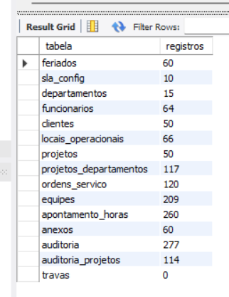

## 4. Parte 3 — Programação em banco de dados

Os objetos abaixo estão em [`scripts/03_programacao.sql`](../scripts/03_programacao.sql): 6 functions, 3 views, 6 stored procedures e 6 triggers. As chamadas de teste estão em [`scripts/04_testes.sql`](../scripts/04_testes.sql). Os prints foram tirados no MySQL Workbench.

Os testes devem ser executados na ordem do arquivo e na mesma aba, porque a procedure P1 cria a variável `@nova_os` usada pelas procedures seguintes e pelos triggers T5 e T6. Os triggers T1 e T2 também aparecem nos prints de P1, P3 e P2.

### 4.1 Functions

#### F1 — fn_calcular_data_sla

**Problema:** O prazo (SLA) das O.S. de manutenção é contado em dias úteis. A função calcula a data limite pulando sábados, domingos e feriados.

**Conceitos:** Laço WHILE e subconsulta na tabela feriados.

**Código SQL** (de [`scripts/03_programacao.sql`](../scripts/03_programacao.sql)):

```sql
CREATE FUNCTION fn_calcular_data_sla(p_abertura DATETIME, p_dias INT)
RETURNS DATETIME
READS SQL DATA
BEGIN
    DECLARE v_data DATE;
    SET v_data = DATE(p_abertura);

    WHILE p_dias > 0 DO
        SET v_data = DATE_ADD(v_data, INTERVAL 1 DAY);
        -- conta o dia só se não for sábado/domingo (1 = domingo, 7 = sábado) nem feriado
        IF DAYOFWEEK(v_data) NOT IN (1, 7)
           AND v_data NOT IN (SELECT data FROM feriados) THEN
            SET p_dias = p_dias - 1;
        END IF;
    END WHILE;

    RETURN TIMESTAMP(v_data, '23:59:59');
END$$
```

**Consulta de teste** (de [`scripts/04_testes.sql`](../scripts/04_testes.sql)):

```sql
SELECT fn_calcular_data_sla('2026-11-19 10:00:00', 5) AS prazo;
```

**Retorno obtido:**

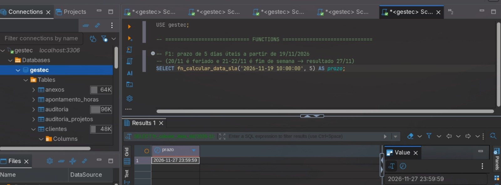

#### F2 — fn_total_horas_os

**Problema:** Saber quantas horas já foram trabalhadas em uma O.S., somando os apontamentos.

**Conceitos:** Função de grupo SUM.

**Código SQL** (de [`scripts/03_programacao.sql`](../scripts/03_programacao.sql)):

```sql
CREATE FUNCTION fn_total_horas_os(p_os_id INT)
RETURNS DECIMAL(10,2)
READS SQL DATA
BEGIN
    DECLARE v_minutos INT;

    SELECT COALESCE(SUM(duracao_minutos), 0) INTO v_minutos
      FROM apontamento_horas
     WHERE os_id = p_os_id;

    RETURN v_minutos / 60;
END$$
```

**Consulta de teste** (de [`scripts/04_testes.sql`](../scripts/04_testes.sql)):

```sql
SELECT id, titulo, fn_total_horas_os(id) AS total_horas
  FROM ordens_servico
 LIMIT 10;
```

**Retorno obtido:**

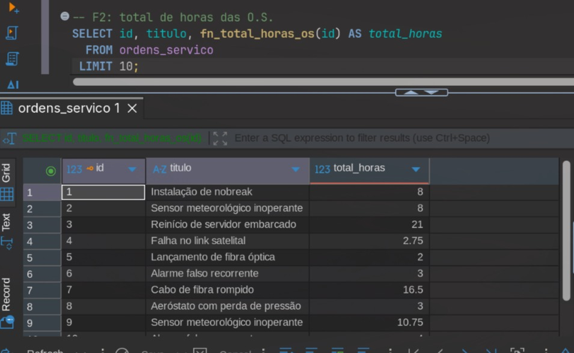

#### F3 — fn_status_sla

**Problema:** Mostrar se a O.S. está no prazo, atrasada, concluída no prazo, concluída com atraso ou sem prazo definido.

**Conceitos:** Estrutura IF / ELSEIF.

**Código SQL** (de [`scripts/03_programacao.sql`](../scripts/03_programacao.sql)):

```sql
CREATE FUNCTION fn_status_sla(p_os_id INT)
RETURNS VARCHAR(30)
READS SQL DATA
BEGIN
    DECLARE v_status VARCHAR(30);
    DECLARE v_limite DATETIME;
    DECLARE v_fim    DATETIME;

    SELECT status, data_limite_sla, data_fim INTO v_status, v_limite, v_fim
      FROM ordens_servico
     WHERE id = p_os_id;

    IF v_limite IS NULL THEN
        RETURN 'SEM PRAZO';
    ELSEIF v_status = 'concluido' AND v_fim <= v_limite THEN
        RETURN 'CONCLUIDA NO PRAZO';
    ELSEIF v_status = 'concluido' THEN
        RETURN 'CONCLUIDA COM ATRASO';
    ELSEIF NOW() > v_limite THEN
        RETURN 'ATRASADA';
    ELSE
        RETURN 'NO PRAZO';
    END IF;
END$$
```

**Consulta de teste** (de [`scripts/04_testes.sql`](../scripts/04_testes.sql)):

```sql
SELECT id, titulo, status, fn_status_sla(id) AS situacao
  FROM ordens_servico
 LIMIT 10;
```

**Retorno obtido:**

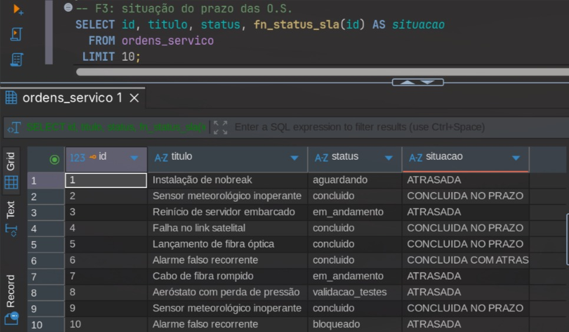

#### F4 — fn_qtd_os_abertas_funcionario

**Problema:** Medir a carga de trabalho de um técnico, contando as O.S. que ainda estão abertas com ele.

**Conceitos:** Função de grupo COUNT.

**Código SQL** (de [`scripts/03_programacao.sql`](../scripts/03_programacao.sql)):

```sql
CREATE FUNCTION fn_qtd_os_abertas_funcionario(p_funcionario_id INT)
RETURNS INT
READS SQL DATA
BEGIN
    DECLARE v_qtd INT;

    SELECT COUNT(*) INTO v_qtd
      FROM ordens_servico
     WHERE responsavel_id = p_funcionario_id
       AND status <> 'concluido'
       AND ativo = TRUE;

    RETURN v_qtd;
END$$
```

**Consulta de teste** (de [`scripts/04_testes.sql`](../scripts/04_testes.sql)):

```sql
SELECT id, nome, fn_qtd_os_abertas_funcionario(id) AS os_abertas
  FROM funcionarios
 WHERE tipo = 'tecnico'
 LIMIT 10;
```

**Retorno obtido:**

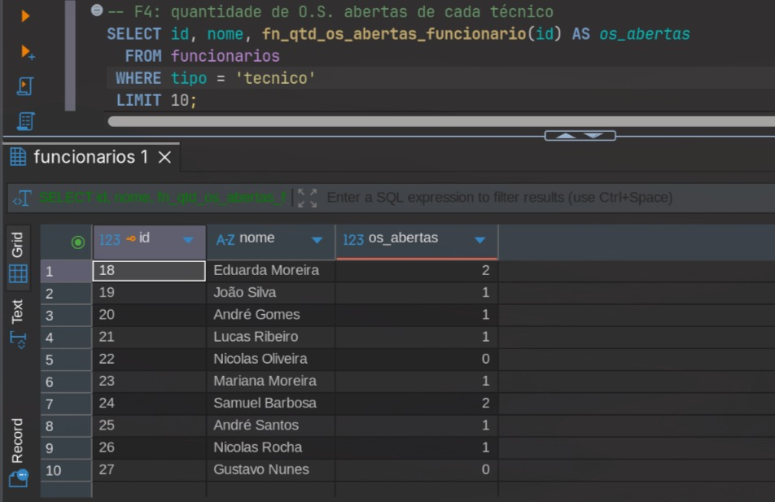

#### F5 — fn_percentual_conclusao_projeto

**Problema:** Acompanhar o andamento de um projeto pelo percentual de O.S. concluídas.

**Conceitos:** COUNT e subconsultas.

**Código SQL** (de [`scripts/03_programacao.sql`](../scripts/03_programacao.sql)):

```sql
CREATE FUNCTION fn_percentual_conclusao_projeto(p_projeto_id INT)
RETURNS DECIMAL(5,2)
READS SQL DATA
BEGIN
    DECLARE v_total      INT;
    DECLARE v_concluidas INT;

    SET v_total      = (SELECT COUNT(*) FROM ordens_servico WHERE projeto_id = p_projeto_id);
    SET v_concluidas = (SELECT COUNT(*) FROM ordens_servico WHERE projeto_id = p_projeto_id
                                                              AND status = 'concluido');
    IF v_total = 0 THEN
        RETURN 0;
    END IF;

    RETURN v_concluidas * 100 / v_total;
END$$
```

**Consulta de teste** (de [`scripts/04_testes.sql`](../scripts/04_testes.sql)):

```sql
SELECT id, nome, fn_percentual_conclusao_projeto(id) AS percentual
  FROM projetos
 LIMIT 10;
```

**Retorno obtido:**

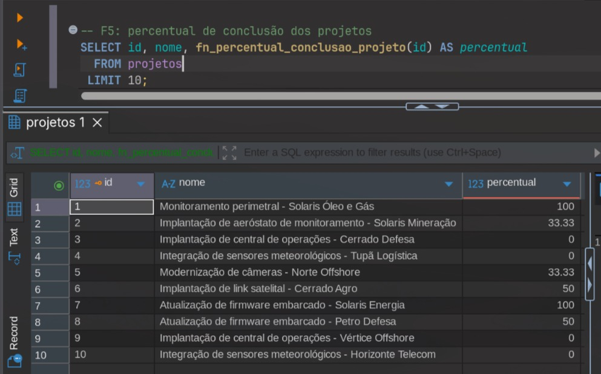

#### F6 — fn_tempo_medio_atendimento_dep

**Problema:** Comparar os departamentos pelo tempo médio, em dias, entre a abertura e a conclusão das O.S.

**Conceitos:** INNER JOIN e função de grupo AVG.

**Código SQL** (de [`scripts/03_programacao.sql`](../scripts/03_programacao.sql)):

```sql
CREATE FUNCTION fn_tempo_medio_atendimento_dep(p_departamento_id INT)
RETURNS DECIMAL(10,2)
READS SQL DATA
BEGIN
    DECLARE v_media DECIMAL(10,2);

    SELECT AVG(DATEDIFF(os.data_fim, os.data_criacao)) INTO v_media
      FROM ordens_servico os
     INNER JOIN departamentos d ON d.id = os.departamento_id
     WHERE d.id = p_departamento_id
       AND os.status = 'concluido';

    RETURN v_media;
END$$
```

**Consulta de teste** (de [`scripts/04_testes.sql`](../scripts/04_testes.sql)):

```sql
SELECT id, nome, fn_tempo_medio_atendimento_dep(id) AS media_dias
  FROM departamentos;
```

**Retorno obtido:**

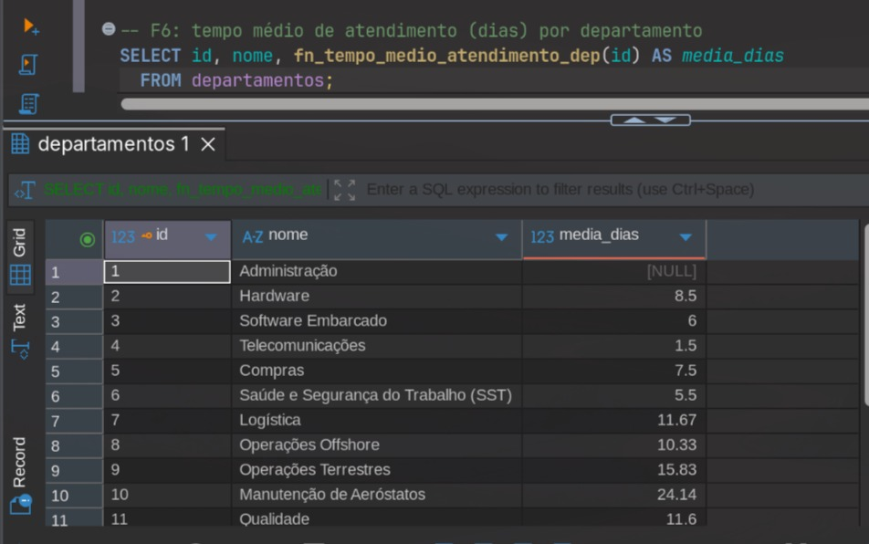

### 4.2 Views

#### V1 — vw_os_detalhada

**Problema:** Nas O.S. aparecem apenas os IDs. A view mostra os nomes do departamento, do solicitante, do responsável e do cliente.

**Conceitos:** INNER JOIN (departamento e solicitante sempre existem) e LEFT JOIN (responsável e cliente podem estar vazios).

**Código SQL** (de [`scripts/03_programacao.sql`](../scripts/03_programacao.sql)):

```sql
CREATE VIEW vw_os_detalhada AS
SELECT os.id,
       os.titulo,
       os.status,
       os.criticidade,
       os.data_limite_sla,
       d.nome    AS departamento,
       sol.nome  AS solicitante,
       resp.nome AS responsavel,
       c.nome    AS cliente
  FROM ordens_servico os
 INNER JOIN departamentos d   ON d.id   = os.departamento_id
 INNER JOIN funcionarios  sol ON sol.id = os.solicitante_id
  LEFT JOIN funcionarios  resp ON resp.id = os.responsavel_id
  LEFT JOIN clientes      c   ON c.id   = os.cliente_id;
```

**Consulta de teste** (de [`scripts/04_testes.sql`](../scripts/04_testes.sql)):

```sql
SELECT id, titulo, departamento, solicitante, responsavel, cliente
  FROM vw_os_detalhada
 LIMIT 10;
```

**Retorno obtido:**

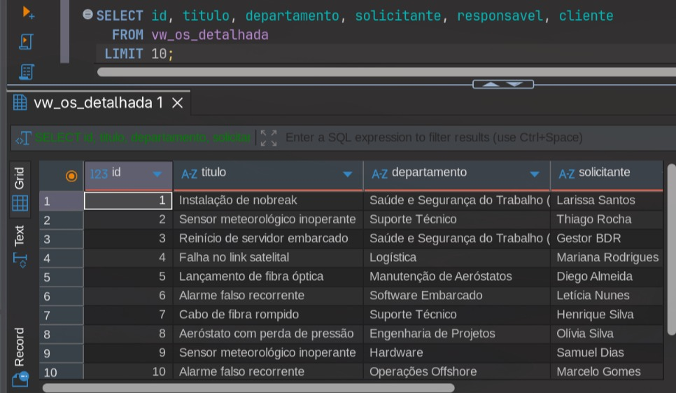

#### V2 — vw_horas_por_funcionario

**Problema:** Ver o total de horas de cada funcionário, inclusive de quem ainda não lançou horas (aparece com 0).

**Conceitos:** RIGHT JOIN, GROUP BY e funções de grupo (COUNT, SUM).

**Código SQL** (de [`scripts/03_programacao.sql`](../scripts/03_programacao.sql)):

```sql
CREATE VIEW vw_horas_por_funcionario AS
SELECT f.id   AS funcionario_id,
       f.nome AS funcionario,
       COUNT(a.id)                                AS qtd_lancamentos,
       COALESCE(SUM(a.duracao_minutos), 0) / 60   AS total_horas
  FROM apontamento_horas a
 RIGHT JOIN funcionarios f ON f.id = a.funcionario_id
 GROUP BY f.id, f.nome;
```

**Consulta de teste** (de [`scripts/04_testes.sql`](../scripts/04_testes.sql)):

```sql
SELECT * FROM vw_horas_por_funcionario LIMIT 10;
```

**Retorno obtido:**

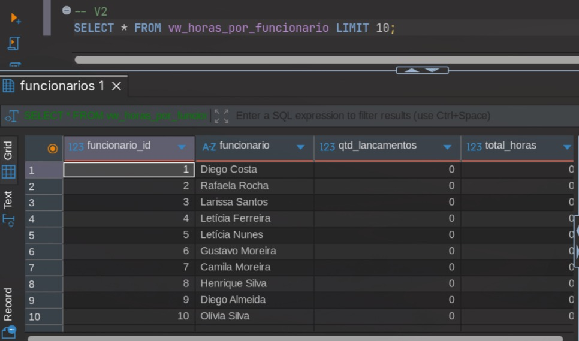

#### V3 — vw_os_atrasadas

**Problema:** Listar as O.S. ainda abertas cujo prazo já venceu.

**Conceitos:** View construída sobre outra view (vw_os_detalhada).

**Código SQL** (de [`scripts/03_programacao.sql`](../scripts/03_programacao.sql)):

```sql
CREATE VIEW vw_os_atrasadas AS
SELECT *
  FROM vw_os_detalhada
 WHERE status <> 'concluido'
   AND data_limite_sla < NOW();
```

**Consulta de teste** (de [`scripts/04_testes.sql`](../scripts/04_testes.sql)):

```sql
SELECT * FROM vw_os_atrasadas LIMIT 10;
```

**Retorno obtido:**

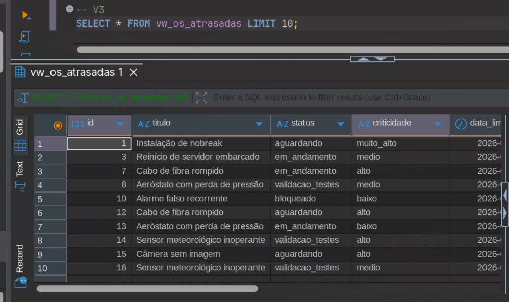

### 4.3 Stored procedures

#### P1 — sp_abrir_os

**Problema:** Abrir uma O.S. garantindo que o solicitante seja gestor ou analista, e devolver o ID criado. O prazo (SLA) é calculado pelo trigger T1.

**Conceitos:** SIGNAL (erro personalizado), subconsulta com EXISTS e parâmetro OUT.

**Código SQL** (de [`scripts/03_programacao.sql`](../scripts/03_programacao.sql)):

```sql
CREATE PROCEDURE sp_abrir_os(
    IN  p_departamento_id INT,
    IN  p_cliente_id      INT,
    IN  p_solicitante_id  INT,
    IN  p_tipo            VARCHAR(20),
    IN  p_criticidade     VARCHAR(20),
    IN  p_titulo          VARCHAR(191),
    IN  p_descricao       TEXT,
    OUT p_os_id           INT
)
BEGIN
    IF NOT EXISTS (SELECT 1 FROM funcionarios
                    WHERE id = p_solicitante_id AND tipo IN ('gestor', 'analista')) THEN
        SIGNAL SQLSTATE '45000' SET MESSAGE_TEXT = 'Somente gestor ou analista pode abrir O.S.';
    END IF;

    INSERT INTO ordens_servico
        (departamento_id, cliente_id, solicitante_id, tipo, criticidade, titulo, descricao, status)
    VALUES
        (p_departamento_id, p_cliente_id, p_solicitante_id, p_tipo, p_criticidade, p_titulo, p_descricao, 'aguardando');

    SET p_os_id = LAST_INSERT_ID();
END$$
```

**Consulta de teste** (de [`scripts/04_testes.sql`](../scripts/04_testes.sql)):

```sql
CALL sp_abrir_os(2, 1, 63, 'manutencao', 'alto', 'Teste BDR', 'O.S. aberta pela procedure', @nova_os);
SELECT id, titulo, tipo, criticidade, status, data_criacao, data_limite_sla
  FROM ordens_servico WHERE id = @nova_os;
```

**Retorno obtido:**

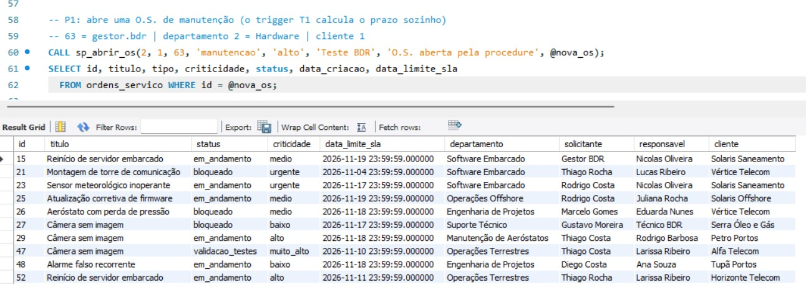

#### P2 — sp_alterar_status_os

**Problema:** Mudar o status de uma O.S. respeitando as regras: O.S. concluída não muda mais e, para concluir, o parecer técnico é obrigatório.

**Conceitos:** SIGNAL e IF.

**Código SQL** (de [`scripts/03_programacao.sql`](../scripts/03_programacao.sql)):

```sql
CREATE PROCEDURE sp_alterar_status_os(
    IN p_os_id       INT,
    IN p_novo_status VARCHAR(30),
    IN p_parecer     TEXT
)
BEGIN
    DECLARE v_status_atual VARCHAR(30);

    SELECT status INTO v_status_atual FROM ordens_servico WHERE id = p_os_id;

    IF v_status_atual = 'concluido' THEN
        SIGNAL SQLSTATE '45000' SET MESSAGE_TEXT = 'O.S. já concluída não pode mudar de status';
    END IF;

    IF p_novo_status = 'concluido' AND (p_parecer IS NULL OR p_parecer = '') THEN
        SIGNAL SQLSTATE '45000' SET MESSAGE_TEXT = 'Informe o parecer técnico para concluir a O.S.';
    END IF;

    UPDATE ordens_servico
       SET status = p_novo_status,
           parecer_tecnico = COALESCE(p_parecer, parecer_tecnico)
     WHERE id = p_os_id;
END$$
```

**Consulta de teste** (de [`scripts/04_testes.sql`](../scripts/04_testes.sql)):

```sql
CALL sp_alterar_status_os(@nova_os, 'concluido', 'Câmera substituída e testada.');
SELECT id, status, parecer_tecnico, data_fim FROM ordens_servico WHERE id = @nova_os;
```

**Retorno obtido:**

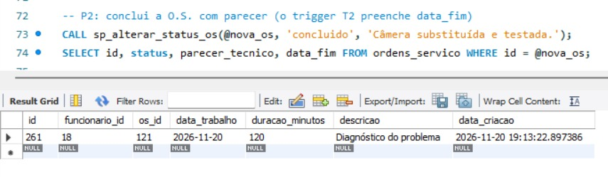

#### P3 — sp_atribuir_responsavel

**Problema:** Atribuir um técnico a uma O.S. O técnico precisa ser do mesmo departamento da O.S. e passa a fazer parte da equipe.

**Conceitos:** Subconsultas, SIGNAL e INSERT IGNORE.

**Código SQL** (de [`scripts/03_programacao.sql`](../scripts/03_programacao.sql)):

```sql
CREATE PROCEDURE sp_atribuir_responsavel(
    IN p_os_id      INT,
    IN p_tecnico_id INT
)
BEGIN
    IF (SELECT departamento_id FROM funcionarios WHERE id = p_tecnico_id)
       <> (SELECT departamento_id FROM ordens_servico WHERE id = p_os_id) THEN
        SIGNAL SQLSTATE '45000' SET MESSAGE_TEXT = 'O técnico precisa ser do mesmo departamento da O.S.';
    END IF;

    UPDATE ordens_servico SET responsavel_id = p_tecnico_id WHERE id = p_os_id;

    -- INSERT IGNORE: se ele já estiver na equipe, não dá erro
    INSERT IGNORE INTO equipes (funcionario_id, os_id) VALUES (p_tecnico_id, p_os_id);
END$$
```

**Consulta de teste** (de [`scripts/04_testes.sql`](../scripts/04_testes.sql)):

```sql
CALL sp_atribuir_responsavel(@nova_os, 18);
SELECT id, titulo, responsavel_id, data_inicio FROM ordens_servico WHERE id = @nova_os;
```

**Retorno obtido:**

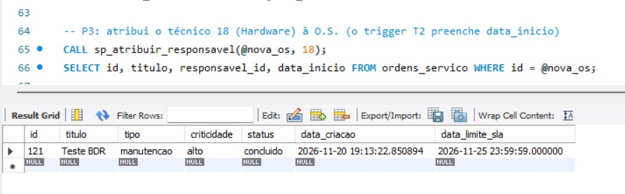

#### P4 — sp_registrar_horas

**Problema:** O técnico registra as horas gastas em uma O.S. A O.S. não pode estar concluída e o funcionário precisa ser o responsável ou fazer parte da equipe. É a procedure usada na Parte 5 (conexão com a API).

**Conceitos:** SIGNAL e subconsultas com EXISTS.

**Código SQL** (de [`scripts/03_programacao.sql`](../scripts/03_programacao.sql)):

```sql
CREATE PROCEDURE sp_registrar_horas(
    IN p_funcionario_id INT,
    IN p_os_id          INT,
    IN p_data           DATE,
    IN p_minutos        INT,
    IN p_descricao      TEXT
)
BEGIN
    IF (SELECT status FROM ordens_servico WHERE id = p_os_id) = 'concluido' THEN
        SIGNAL SQLSTATE '45000' SET MESSAGE_TEXT = 'Não é possível lançar horas em O.S. concluída';
    END IF;

    IF NOT EXISTS (SELECT 1 FROM ordens_servico WHERE id = p_os_id AND responsavel_id = p_funcionario_id)
       AND NOT EXISTS (SELECT 1 FROM equipes WHERE os_id = p_os_id AND funcionario_id = p_funcionario_id) THEN
        SIGNAL SQLSTATE '45000' SET MESSAGE_TEXT = 'Somente o responsável ou a equipe da O.S. pode lançar horas';
    END IF;

    INSERT INTO apontamento_horas (funcionario_id, os_id, data_trabalho, duracao_minutos, descricao)
    VALUES (p_funcionario_id, p_os_id, p_data, p_minutos, p_descricao);
END$$
```

**Consulta de teste** (de [`scripts/04_testes.sql`](../scripts/04_testes.sql)):

```sql
CALL sp_registrar_horas(18, @nova_os, CURDATE(), 120, 'Diagnóstico do problema');
SELECT * FROM apontamento_horas WHERE os_id = @nova_os;
```

**Retorno obtido:**

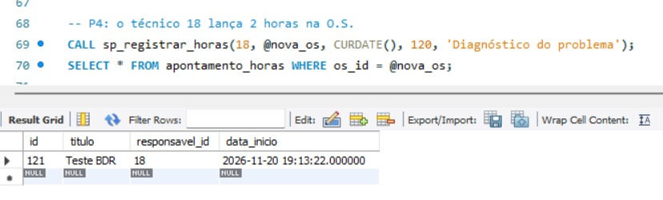

#### P5 — sp_relatorio_cliente

**Problema:** Gerar o relatório de um cliente com as suas O.S., as horas trabalhadas e a situação do prazo de cada uma.

**Conceitos:** CURSOR (percorre as O.S. uma a uma), HANDLER, tabela temporária e uso das functions F2 e F3.

**Código SQL** (de [`scripts/03_programacao.sql`](../scripts/03_programacao.sql)):

```sql
CREATE PROCEDURE sp_relatorio_cliente(IN p_cliente_id INT)
BEGIN
    DECLARE v_fim    INT DEFAULT 0;
    DECLARE v_id     INT;
    DECLARE v_titulo VARCHAR(191);
    DECLARE v_status VARCHAR(30);

    DECLARE cur_os CURSOR FOR
        SELECT id, titulo, status FROM ordens_servico WHERE cliente_id = p_cliente_id;
    DECLARE CONTINUE HANDLER FOR NOT FOUND SET v_fim = 1;

    DROP TEMPORARY TABLE IF EXISTS tmp_relatorio;
    CREATE TEMPORARY TABLE tmp_relatorio (
        os_id    INT,
        titulo   VARCHAR(191),
        status   VARCHAR(30),
        horas    DECIMAL(10,2),
        situacao VARCHAR(30)
    );

    OPEN cur_os;
    leitura: LOOP
        FETCH cur_os INTO v_id, v_titulo, v_status;
        IF v_fim = 1 THEN
            LEAVE leitura;
        END IF;
        INSERT INTO tmp_relatorio
        VALUES (v_id, v_titulo, v_status, fn_total_horas_os(v_id), fn_status_sla(v_id));
    END LOOP;
    CLOSE cur_os;

    SELECT * FROM tmp_relatorio;
END$$
```

**Consulta de teste** (de [`scripts/04_testes.sql`](../scripts/04_testes.sql)):

```sql
CALL sp_relatorio_cliente(1);
```

**Retorno obtido:**

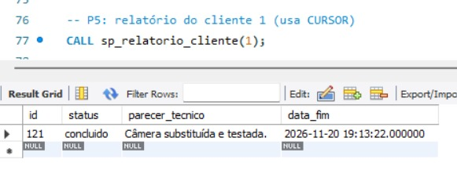

#### P6 — sp_resumo_departamentos

**Problema:** Ver, por departamento, quantas O.S. existem, quantas estão abertas e quantas foram concluídas.

**Conceitos:** LEFT JOIN, GROUP BY e funções de grupo (COUNT, SUM).

**Código SQL** (de [`scripts/03_programacao.sql`](../scripts/03_programacao.sql)):

```sql
CREATE PROCEDURE sp_resumo_departamentos()
BEGIN
    SELECT d.nome                                     AS departamento,
           COUNT(os.id)                               AS total_os,
           COALESCE(SUM(os.status <> 'concluido'), 0) AS abertas,
           COALESCE(SUM(os.status = 'concluido'), 0)  AS concluidas
      FROM departamentos d
      LEFT JOIN ordens_servico os ON os.departamento_id = d.id
     GROUP BY d.nome
     ORDER BY total_os DESC;
END$$
```

**Consulta de teste** (de [`scripts/04_testes.sql`](../scripts/04_testes.sql)):

```sql
CALL sp_resumo_departamentos();
```

**Retorno obtido:**

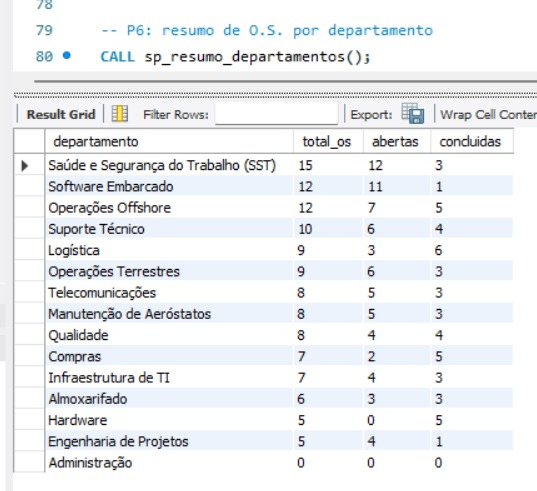

### 4.4 Triggers

Os triggers T3, T5 e T6 bloqueiam operações incorretas. Nesses casos, o retorno obtido é a mensagem de erro, que é o resultado esperado.

#### T1 — trg_os_bi_sla (antes de inserir uma O.S.)

**Problema:** Toda O.S. de manutenção precisa nascer com o prazo calculado conforme a criticidade (tabela sla_config), sem depender de quem cadastra.

**Conceitos:** BEFORE INSERT e uso da function F1.

**Código SQL** (de [`scripts/03_programacao.sql`](../scripts/03_programacao.sql)):

```sql
CREATE TRIGGER trg_os_bi_sla
BEFORE INSERT ON ordens_servico
FOR EACH ROW
BEGIN
    DECLARE v_prazo INT;

    IF NEW.tipo = 'manutencao' AND NEW.data_limite_sla IS NULL THEN
        SELECT prazo_dias_uteis INTO v_prazo
          FROM sla_config
         WHERE tipo = 'manutencao' AND criticidade = NEW.criticidade;

        SET NEW.prazo_dias_uteis = v_prazo;
        SET NEW.data_limite_sla  = fn_calcular_data_sla(NOW(), v_prazo);
    END IF;
END$$
```

**Consulta de teste** (de [`scripts/04_testes.sql`](../scripts/04_testes.sql)):

```sql
INSERT INTO ordens_servico (departamento_id, cliente_id, solicitante_id, tipo, criticidade, titulo, descricao, status)
VALUES (2, 1, 63, 'manutencao', 'urgente', 'Teste T1', 'Teste direto do trigger de SLA', 'aguardando');
SELECT id, titulo, criticidade, prazo_dias_uteis, data_criacao, data_limite_sla
  FROM ordens_servico WHERE id = LAST_INSERT_ID();
```

**Retorno obtido:**

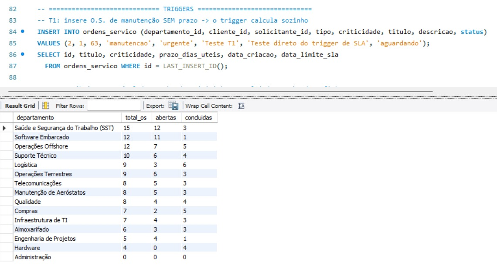

#### T2 — trg_os_bu_datas (antes de atualizar uma O.S.)

**Problema:** Preencher sozinho a data de início (quando a O.S. recebe um responsável) e a data de fim (quando é concluída).

**Conceitos:** BEFORE UPDATE.

**Código SQL** (de [`scripts/03_programacao.sql`](../scripts/03_programacao.sql)):

```sql
CREATE TRIGGER trg_os_bu_datas
BEFORE UPDATE ON ordens_servico
FOR EACH ROW
BEGIN
    IF NEW.responsavel_id IS NOT NULL AND NEW.data_inicio IS NULL THEN
        SET NEW.data_inicio = NOW();
    END IF;

    IF NEW.status = 'concluido' AND NEW.data_fim IS NULL THEN
        SET NEW.data_fim = NOW();
    END IF;
END$$
```

**Consulta de teste** (de [`scripts/04_testes.sql`](../scripts/04_testes.sql)):

```sql
SELECT id, status, responsavel_id, data_inicio, data_fim FROM ordens_servico WHERE id = 32;
UPDATE ordens_servico SET responsavel_id = 30 WHERE id = 32;
UPDATE ordens_servico SET status = 'concluido', parecer_tecnico = 'Teste T2' WHERE id = 32;
SELECT id, status, responsavel_id, data_inicio, data_fim FROM ordens_servico WHERE id = 32;
```

**Retorno obtido:**

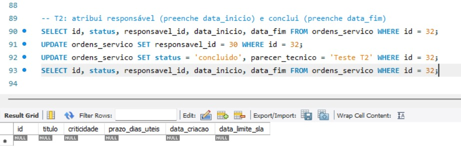

#### T3 — trg_clientes_bu_inativar (antes de atualizar um cliente)

**Problema:** Não deixar inativar um cliente que ainda tem O.S. abertas.

**Conceitos:** BEFORE UPDATE, subconsulta com EXISTS e SIGNAL. O retorno esperado é a mensagem de erro.

**Código SQL** (de [`scripts/03_programacao.sql`](../scripts/03_programacao.sql)):

```sql
CREATE TRIGGER trg_clientes_bu_inativar
BEFORE UPDATE ON clientes
FOR EACH ROW
BEGIN
    IF OLD.ativo = TRUE AND NEW.ativo = FALSE
       AND EXISTS (SELECT 1 FROM ordens_servico
                    WHERE cliente_id = NEW.id AND status <> 'concluido' AND ativo = TRUE) THEN
        SIGNAL SQLSTATE '45000' SET MESSAGE_TEXT = 'Cliente possui O.S. abertas e não pode ser inativado';
    END IF;
END$$
```

**Consulta de teste** (de [`scripts/04_testes.sql`](../scripts/04_testes.sql)):

```sql
UPDATE clientes SET ativo = FALSE
 WHERE id = (SELECT cliente_id FROM ordens_servico WHERE status <> 'concluido' AND ativo = TRUE LIMIT 1);
```

**Retorno obtido:**

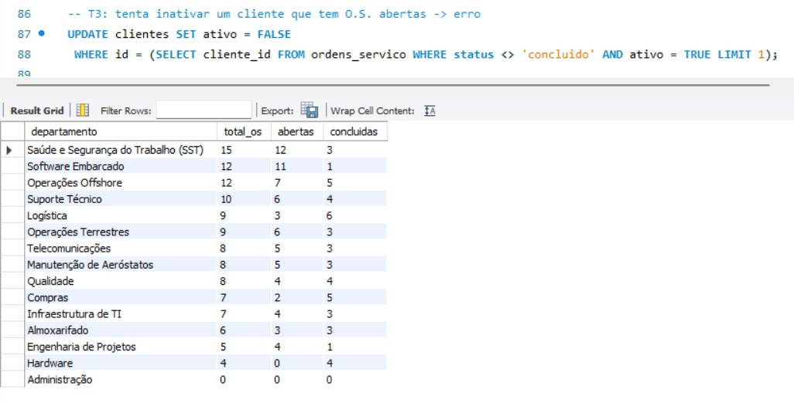

#### T4 — trg_projetos_bu_datas (antes de atualizar um projeto)

**Problema:** Registrar sozinho as datas de início e fim do projeto quando o status muda para em_andamento ou concluido.

**Conceitos:** BEFORE UPDATE.

**Código SQL** (de [`scripts/03_programacao.sql`](../scripts/03_programacao.sql)):

```sql
CREATE TRIGGER trg_projetos_bu_datas
BEFORE UPDATE ON projetos
FOR EACH ROW
BEGIN
    IF NEW.status = 'em_andamento' AND NEW.data_inicio IS NULL THEN
        SET NEW.data_inicio = NOW();
    END IF;

    IF NEW.status = 'concluido' AND NEW.data_fim IS NULL THEN
        SET NEW.data_fim = NOW();
    END IF;
END$$
```

**Consulta de teste** (de [`scripts/04_testes.sql`](../scripts/04_testes.sql)):

```sql
UPDATE projetos SET status = 'concluido' WHERE id = 2;
SELECT id, nome, status, data_fim FROM projetos WHERE id = 2;
```

**Retorno obtido:**

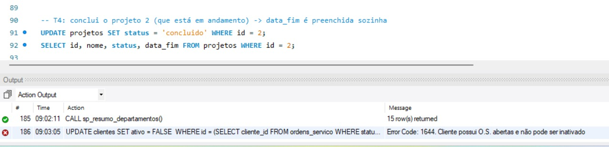

#### T5 — trg_horas_bi_validacao (antes de inserir horas)

**Problema:** Impedir o lançamento de horas em data futura e impedir mais de 24 horas no mesmo dia para o mesmo funcionário.

**Conceitos:** BEFORE INSERT, subconsulta com SUM e SIGNAL. O retorno esperado é a mensagem de erro.

**Código SQL** (de [`scripts/03_programacao.sql`](../scripts/03_programacao.sql)):

```sql
CREATE TRIGGER trg_horas_bi_validacao
BEFORE INSERT ON apontamento_horas
FOR EACH ROW
BEGIN
    IF NEW.data_trabalho > CURDATE() THEN
        SIGNAL SQLSTATE '45000' SET MESSAGE_TEXT = 'Não é permitido lançar horas em data futura';
    END IF;

    IF (SELECT COALESCE(SUM(duracao_minutos), 0) FROM apontamento_horas
         WHERE funcionario_id = NEW.funcionario_id AND data_trabalho = NEW.data_trabalho)
       + NEW.duracao_minutos > 1440 THEN
        SIGNAL SQLSTATE '45000' SET MESSAGE_TEXT = 'Limite de 24 horas por dia excedido';
    END IF;
END$$
```

**Consulta de teste** (de [`scripts/04_testes.sql`](../scripts/04_testes.sql)):

```sql
INSERT INTO apontamento_horas (funcionario_id, os_id, data_trabalho, duracao_minutos)
VALUES (18, @nova_os, CURDATE() + INTERVAL 1 DAY, 60);
```

**Retorno obtido:**

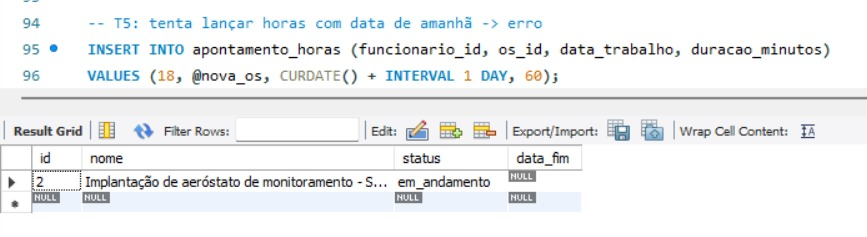

#### T6 — trg_anexos_bi_limite (antes de inserir um anexo)

**Problema:** Limitar a 10 o número de anexos de cada O.S.

**Conceitos:** BEFORE INSERT, subconsulta com COUNT e SIGNAL. O retorno esperado é a mensagem de erro.

**Código SQL** (de [`scripts/03_programacao.sql`](../scripts/03_programacao.sql)):

```sql
CREATE TRIGGER trg_anexos_bi_limite
BEFORE INSERT ON anexos
FOR EACH ROW
BEGIN
    IF (SELECT COUNT(*) FROM anexos WHERE os_id = NEW.os_id) >= 10 THEN
        SIGNAL SQLSTATE '45000' SET MESSAGE_TEXT = 'Limite de 10 anexos por O.S. atingido';
    END IF;
END$$
```

**Consulta de teste** (de [`scripts/04_testes.sql`](../scripts/04_testes.sql)):

```sql
INSERT INTO anexos (os_id, funcionario_id, nome, tamanho_bytes, caminho, tipo)
SELECT @nova_os, 18, CONCAT('foto', n, '.jpg'), 1000, CONCAT('teste/foto', n, '.jpg'), 'image/jpeg'
  FROM (SELECT 1 n UNION SELECT 2 UNION SELECT 3 UNION SELECT 4 UNION SELECT 5 UNION SELECT 6
        UNION SELECT 7 UNION SELECT 8 UNION SELECT 9 UNION SELECT 10 UNION SELECT 11) AS numeros;
```

**Retorno obtido:**

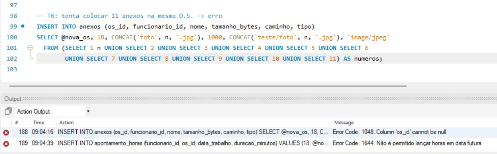

## 5. Parte 4 — Documentação do banco de dados (dicionário de dados)

O dicionário de dados completo está no arquivo separado [`dicionario_de_dados.md`](../dicionario_de_dados.md). Para cada uma das 15 tabelas ele traz a descrição, os campos, os tipos de dados, as chaves primárias e estrangeiras, as restrições (UNIQUE, CHECK e índices) e a quantidade de registros do script de carga. Ele também lista as functions, views, procedures e triggers criados.

Resumo das chaves do banco:

| Tabela | Chave primária | Chaves estrangeiras |
|---|---|---|
| `feriados` | id | — |
| `sla_config` | id | — |
| `travas` | chave | — |
| `departamentos` | id | responsavel_id → funcionarios |
| `funcionarios` | id | departamento_id → departamentos |
| `clientes` | id | — |
| `locais_operacionais` | id | cliente_id → clientes |
| `projetos` | id | cliente_id → clientes |
| `projetos_departamentos` | projeto_id + departamento_id | projeto_id → projetos; departamento_id → departamentos |
| `ordens_servico` | id | departamento_id, cliente_id, solicitante_id, responsavel_id, projeto_id, anterior_id (autorrelacionamento), ativo_id, sla_config_id |
| `equipes` | funcionario_id + os_id | funcionario_id → funcionarios; os_id → ordens_servico |
| `apontamento_horas` | id | funcionario_id → funcionarios; os_id → ordens_servico |
| `anexos` | id | os_id → ordens_servico; funcionario_id → funcionarios |
| `auditoria` | id | os_id → ordens_servico; funcionario_id → funcionarios |
| `auditoria_projetos` | id | projeto_id → projetos; funcionario_id → funcionarios |

## 6. Parte 5 — Conexão do projeto API ao banco de dados

### 6.1 Funcionalidade escolhida

A funcionalidade escolhida foi o registro de horas trabalhadas na O.S. (US#2.7). Antes, ela existia apenas como demonstração na tela. Agora ela grava no banco, usando uma procedure, uma function e um trigger do banco desenvolvido nesta avaliação.

| Objeto do banco | Papel na funcionalidade |
|---|---|
| `sp_registrar_horas` (procedure) | Grava o lançamento de horas, validando se a O.S. está aberta e se o funcionário é o responsável ou da equipe |
| `fn_total_horas_os` (function) | Calcula o total de horas da O.S., exibido na tela como tempo registrado |
| `trg_horas_bi_validacao` (trigger) | Bloqueia lançamento em data futura e mais de 24 horas por dia |

### 6.2 Arquivos envolvidos

| Camada | Arquivo | O que usa do banco |
|---|---|---|
| Banco | `scripts/03_programacao.sql` | `sp_registrar_horas`, `fn_total_horas_os` e `trg_horas_bi_validacao` |
| API | `sgos-mysql/backend/src/repositories/repositoryApontamento.ts` | `CALL sp_registrar_horas(...)` e `SELECT fn_total_horas_os(...)` |
| API | `services/serviceApontamento.ts`, `controllers/controllerApontamento.ts` e `routes/routeOrdemServico.ts` | Rotas `GET` e `POST /ordens-servico/:id/horas` |
| Tela | `frontend/src/services/apontamento.ts` e `components/ordens/OrdemServicoDetalhesModal.tsx` | Botão Lançar horas e aba Horas registradas |

### 6.3 Fluxo da funcionalidade

1. O técnico abre a O.S. na tela e clica em **Lançar horas**.
2. A tela envia a requisição para a rota `POST /ordens-servico/:id/horas` da API.
3. O repositório da API executa `CALL sp_registrar_horas(...)` no banco.
4. A procedure valida as regras e insere o lançamento; o trigger valida a data e o limite de 24 horas por dia.
5. A aba **Horas registradas** lista os lançamentos e mostra o total calculado por `fn_total_horas_os`.

**Trecho do código da API que chama a procedure e a function:**

Arquivo: `sgos-mysql/backend/src/repositories/repositoryApontamento.ts`

```ts
/**
 * repositories/repositoryApontamento.ts
 *
 * US#2.7 — registro de horas trabalhadas nas O.S. (Parte 5 da avaliação de BDR).
 *
 * Esta funcionalidade usa programação no banco MySQL em vez de regras no Node:
 *  - stored procedure `sp_registrar_horas`: valida e grava o apontamento
 *    (O.S. não concluída; funcionário responsável ou da equipe da O.S.);
 *  - trigger `trg_horas_bi_validacao`: barra data futura e mais de 24h por dia
 *    (disparado automaticamente pelo INSERT da procedure);
 *  - function `fn_total_horas_os`: soma as horas já lançadas na O.S.
 *
 * Erros de regra disparados no banco com SIGNAL SQLSTATE '45000' (código MySQL 1644)
 * viram AppError 400 com a mesma mensagem escrita na procedure/trigger.
 */
import { prisma } from '../prisma/client';
import { Prisma } from '../prisma/generated/client';
import { AppError } from '../errors/AppError';

/** Código de erro do MySQL/MariaDB para SIGNAL SQLSTATE '45000' (erro definido pelo usuário). */
const ERRO_REGRA_DO_BANCO = '1644';

export interface ApontamentoHoras {
    id: number;
    os_id: number;
    data_trabalho: Date;
    duracao_minutos: number;
    descricao: string | null;
    data_criacao: Date;
    funcionarios: { id: number; nome: string };
}

/**
 * Converte o erro de SIGNAL vindo do banco em AppError 400.
 * Com driver adapter, o Prisma embala o erro do MySQL numa mensagem do tipo
 * "Raw query failed. Code: `1644`. Message: `<texto do SIGNAL>`".
 */
function traduzirErroDoBanco(erro: unknown): unknown {
    if (!(erro instanceof Prisma.PrismaClientKnownRequestError)) return erro;

    const texto = erro.message;
    const codigo = /Code: `(\d+)`/.exec(texto)?.[1];
    if (codigo !== ERRO_REGRA_DO_BANCO) return erro;

    const mensagem = /Message: `([^`]*)`/.exec(texto)?.[1];
    return AppError.requisicaoInvalida(mensagem ?? 'Operação recusada pelas regras do banco de dados');
}

export class RepositoryApontamento {
    /** Chama a stored procedure sp_registrar_horas (o trigger de validação dispara junto). */
    async registrar(
        funcionarioId: number,
        osId: number,
        dataTrabalho: string,
        minutos: number,
        descricao: string | null,
    ): Promise<void> {
        try {
            await prisma.$executeRaw`CALL sp_registrar_horas(${funcionarioId}, ${osId}, ${dataTrabalho}, ${minutos}, ${descricao})`;
        } catch (erro) {
            throw traduzirErroDoBanco(erro);
        }
    }

    /** Chama a function fn_total_horas_os: total de horas lançadas na O.S. */
    async totalHoras(osId: number): Promise<number> {
        const [linha] = await prisma.$queryRaw<Array<{ total: unknown }>>`SELECT fn_total_horas_os(${osId}) AS total`;
        return Number(linha?.total ?? 0);
    }

    /** Lista os apontamentos da O.S. com o nome de quem lançou, mais recentes primeiro. */
    async listarPorOrdem(osId: number): Promise<ApontamentoHoras[]> {
        return prisma.apontamento_horas.findMany({
            where: { os_id: osId },
            select: {
                id: true,
                os_id: true,
                data_trabalho: true,
                duracao_minutos: true,
                descricao: true,
                data_criacao: true,
                funcionarios: { select: { id: true, nome: true } },
            },
            orderBy: [{ data_trabalho: 'desc' }, { id: 'desc' }],
        });
    }

    /** Confere se a O.S. existe (para responder 404 em vez de lista vazia). */
    async ordemExiste(osId: number): Promise<boolean> {
        const os = await prisma.ordens_servico.findUnique({ where: { id: osId }, select: { id: true } });
        return os !== null;
    }
}

export const repositoryApontamento = new RepositoryApontamento();
```

### 6.4 Testes da funcionalidade

**API-1:** Formulário **Lançar horas** preenchido.

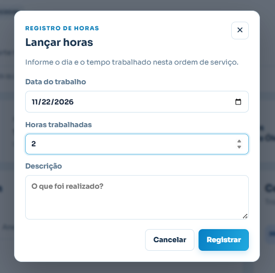

**API-2:** Aba **Horas registradas** com o lançamento e o tempo registrado atualizado (total vindo de `fn_total_horas_os`).

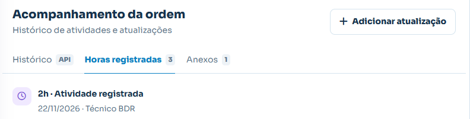

**API-3:** Mensagem de erro na tela ao ultrapassar 24 horas no mesmo dia (vem do trigger do banco).

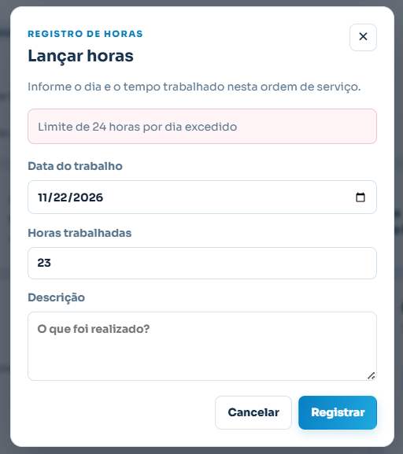

**API-4:** Registro gravado no banco (consulta no MySQL Workbench).

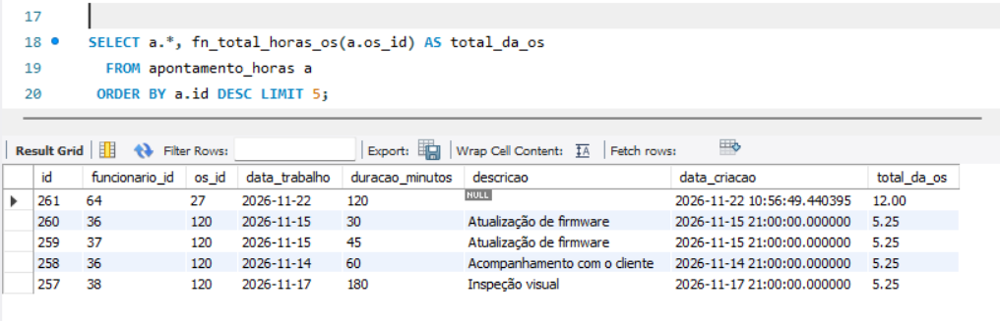

